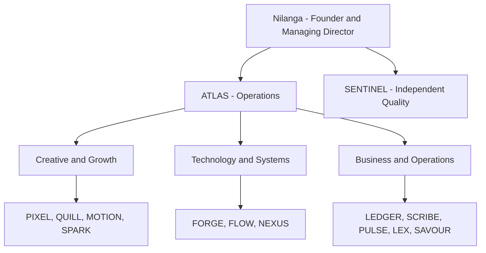

# Organisation and operating model

Nilanga is Founder & Managing Director. ATLAS owns delivery coordination. SENTINEL has an independent reporting line to Nilanga. Other specialists report operationally to ATLAS. Use a single MausBot section so the Chief can reach its team without extra cross-department grants.

Group labels describe responsibilities; they are not additional manager bots or app sections.

## Delegation contract

Each assignment includes job ID, client/project folder, objective, exact input paths, output format/path, constraints, dependencies, done_when and authorised actions. Start with two independent production workers, one writer per file and one review cycle. Simple jobs go directly to one worker. Use live IDs, not imaginary conversations. Respect asynchronous returns; no polling or acknowledgement loops.

## Job record

Record: job_id, owner, status, input_paths, output_paths, acceptance_checks, actual_check_results, assumptions, blocker, next_action, updated_at. Statuses: not-started, in-progress, blocked, review, done. Keep it in the private project folder, never a public skill repository.

## Definition of done

Output exists in the requested format; required checks ran and results are recorded; assumptions/exceptions are visible; the reviewer assessed actual output; authorised publication/posting is either completed with evidence or explicitly pending. A draft is not a posted transaction, generated code is not a deployed app, a storyboard is not an exported video, and an AI review is not a statutory audit opinion.

## Examples

Restaurant POS: SAVOUR maps processes; LEDGER checks cost/accounting requirements; NEXUS implements in staging; FORGE/FLOW handle scoped extensions; SENTINEL tests sales, returns, stock and reconciliation.

Payroll: PULSE prepares period-specific rules/calculations; LEDGER reconciles; LEX addresses material employment interpretation; NEXUS implements system changes; Nilanga approves final payroll. No autonomous bank payments.

Website: PIXEL and QUILL create independent inputs after brief approval; FORGE implements; SPARK checks agreed SEO scope; SENTINEL tests. Only activate needed workers.

## Measurement

Log elapsed time, API usage/cost where available, retries, first-review defects and Nilanga correction time. Compare identical representative tasks before increasing concurrency or changing models. No speed claim has been benchmarked for this bundle yet.
